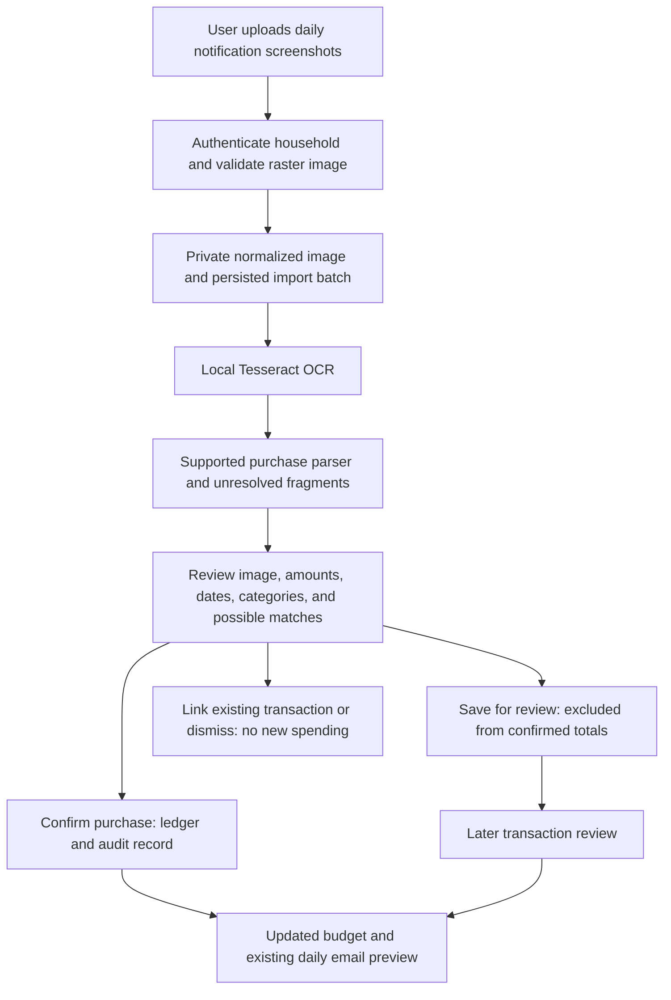

# Daily screenshot ingestion

Status: implemented and tested in the local prototype. The input is a manual,
authenticated web upload. Public hosting and scheduled email delivery are still
separate launch tasks. Images attached to a chat or emailed to an address are
not automatically ingested by this application.

## Data flow

## Components and boundaries

| Component | Responsibility |
| --- | --- |
| `screenshot_routes.py` | Signed-in upload, private image viewing, batch history and review decisions |
| `screenshots.py` | Raster validation, metadata stripping, local OCR, candidate staging and match checks |
| `notifications.py` | Strict supported purchase parsing; no guessing of missing amounts or transaction types |
| `screenshot_batches` | Household, image hash, processing state, attempt, errors and full OCR text |
| `screenshot_items` | Original OCR fragment, edited text, parsed fields, review state and linked transaction |
| Existing ledger and notification metadata | Confirmed/review transactions, precise source timestamp and manual correction audit |
| Existing budget and recap | Read confirmed ledger data; do not read raw images or OCR text |

Images are PNG/JPEG/WebP only, at most 6 MB and 12 megapixels. Pixel decoding,
single-frame checks, orientation normalization, and re-encoding prevent trusting
filenames or MIME labels and strip metadata. Stored names are server-generated
UUIDs. Image reads, uploads, retries, and decisions are household-scoped;
mutations require the existing CSRF protection. Source images may contain bank
balances and should be treated as sensitive even though those values never
become purchase amounts.

## Processing and review states

A batch moves from `queued` to `processing`, then `review` or `failed`. Once all
its items are saved, linked, or dismissed, the batch is `complete`. Complete
means the import review is finished; transactions saved for later review still
do not count toward spending.

For this small prototype, OCR runs synchronously during the upload request, in a
local subprocess limited to one thread and 25 seconds. Failed jobs retain the
private image and can be retried. Processing interrupted by a restart can be
retried after one minute. Attempt numbers prevent an older extraction from
overwriting a newer retry. Larger deployments should run the same persisted
batch processor in a supervised background worker; no such worker is currently
required or started.

OCR never posts directly to the ledger. Complete supported messages become
review candidates; incomplete and unrecognized financial fragments are kept for
attention. An empty OCR result is also unresolved. A user can correct extracted
text and parse it again, save a candidate as pending, confirm a categorized
purchase, or exclude an item. Confirmation records an audit event. Original OCR
fragments survive text edits.

## Repeated and overlapping screenshots

- A normalized-image hash is unique per household: an identical upload opens the
  existing batch rather than reprocessing or reimporting it.
- Possible ledger matches compare amount, currency, and original merchant. If
  bank notification timestamps and card suffixes exist, those must also match;
  otherwise a same-local-date match is a weaker candidate for user review.
- An overlap cannot silently become new spending: choose the existing record or
  explicitly identify it as a separate purchase. Different timestamps or amounts
  can represent separate purchases at the same merchant.
- Transaction creation and item completion occur in one SQLite write transaction.
  Repeated submissions of a saved item reuse its result, and stale edit versions
  cannot overwrite a newer review.

These are review safeguards, not proof of bank identity. Different merchant
wording between statements and notifications may evade a possible-match check.
Statements remain necessary for completeness and final reconciliation.

## Operational requirements and limits

- Python dependencies are hash-locked. The prepared cloud runtime includes
  Tesseract 5.5 and English language data; CI installs Tesseract 5 from signed
  Ubuntu packages. No AI service key or banking credentials are needed for OCR.
- Supported initial content is English ADCB credit-card purchase notifications.
  Refunds, transfers, declined charges, and other layouts require additional
  verified parsers or manual entry. HEIC, PDFs, chat ingestion, and email ingestion
  are not supported by the screenshot uploader.
- OCR can misread a valid-looking amount. Every candidate must be checked against
  the image; parser success is not an accuracy guarantee. No confidence score
  permits automatic confirmation.
- Upload expanded notifications; capture multiple images when necessary. Hidden,
  dismissed, or cropped notifications cannot be reconstructed. No upload means
  no new data, not proof of no spending.
- The private data directory must be persistent in production and backed up
  together with the SQLite database and signing key. Encryption at rest,
  retention/deletion policy, disk quotas, production HTTPS hosting, and recovery
  procedures still need to be configured before loading real household data.
- The email remains a preview until delivery is connected. When a sender is
  added, it must send from the reviewed ledger with its data cutoff visible,
  never from raw screenshot text.

All committed examples and automated screenshot tests use fictional financial
records. Real screenshots are never repository fixtures or public artifacts.
